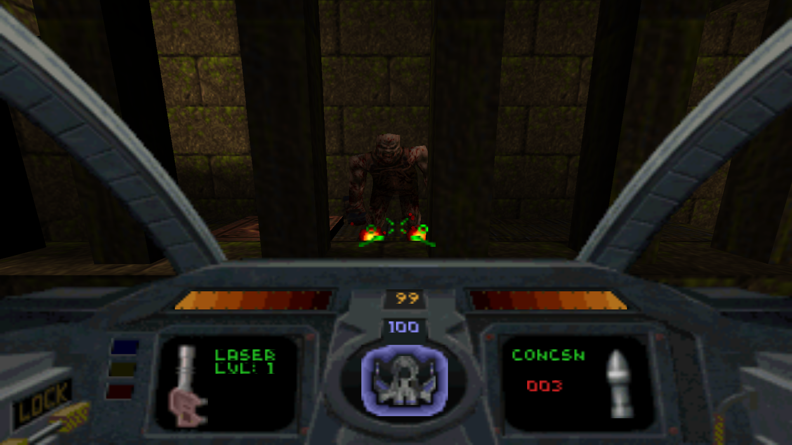

# Quakescent

Quake plus Descent: fly the Pyro-GX through Quake's levels with Descent's
six-degrees-of-freedom flight, cockpit and weapons.



Quakescent is a mod for an unmodified [FTEQW](https://www.fteqw.org/), a
Quake engine. Quake's monsters, maps and music stay as they are. You become
Descent's ship:

- **Full 6DOF flight.** Thrust, slide and bank, loop and fly upside down,
  with Descent's own ship physics.
- **Descent's cockpit.** Energy and shield gauges, the shield ring, key
  lights, weapon boxes and the reticle, laid out as in Descent, plus the
  rear view and Descent's message line.
- **Descent's weapons.**
  - Primaries: lasers (levels 1-4 plus quad), vulcan, spreadfire, plasma and
    fusion (hold fire to charge).
  - Secondaries: concussion, homing and smart missiles, proximity bombs and
    the mega missile. Plus flares.
  - Damage, speed, fire rate and energy use come from Descent's weapon
    table, and the shots use Descent's own models and effects.
- **Descent's powerups.** Quake's pickups become Descent's spinning
  powerups (see below).
- **Descent II mode** (optional): Descent II's cockpit, sounds, weapons and
  equipment. See below.
- **Descent's cheat codes** (`gabbagabbahey`, `racerx`, `porgys`...), typed
  during play. Quake's own cheats (`god`, `noclip`, `impulse 9`) still work.
- **Doors and switches** open when you fly into them, and switches can be
  shot, as in Descent.

## Install and play (Windows)

1. Download the latest `Quakescent-x.y.z.zip` from
   [Releases](https://github.com/wootbeer/Quakescent/releases) and unzip it
   anywhere, e.g. `C:\Games\Quakescent`.
2. Copy your game files in:
   - Quake's `PAK0.PAK` and `PAK1.PAK` into the `id1` folder. They're in
     the `id1` folder of your Quake. For the 2021 re-release (Steam, GOG),
     copy `rerelease\id1\pak0.pak` instead; it holds the whole game. The
     shareware `PAK0.PAK` works too (episode 1 only).
   - `DESCENT.HOG` and `DESCENT.PIG` from Descent 1 into the `data` folder.
     The registered game (1.4/1.5) and the 1.0-1.2 shareware both work.
3. Double-click `Quakescent.bat`.

For **Descent II mode**, also copy `DESCENT2.HOG`, `DESCENT2.HAM`,
`GROUPA.PIG` and `DESCENT2.S22` from Descent II into `data` and start
`Quakescent2.bat` instead. If `data` only has Descent II's files,
`Quakescent.bat` uses Descent II mode too.

On the first run the launcher:

- offers to download FTEQW into an `fte` folder (or set the `FTEQW`
  environment variable to an existing `fteqw64.exe`);
- converts your Descent files into an asset pack (cockpit, gauges, sprites,
  models, sounds, fonts) in `descent1` (or `descent2`).

Then pick New Game from Quake's menu, or start a map directly:
`Quakescent.bat +map e1m1 +skill 2`.

**No game data is included.** The asset pack the launcher makes contains
Descent's data, so don't share it. Quake and Descent are sold on GOG and
Steam.

Windows SmartScreen or antivirus may be wary of `tools\qsconvert.exe`,
since it isn't code-signed. It is built from `tools/qsconvert.py` by this
repository's GitHub Actions. With Python 3 installed you can delete the exe
and the launcher will run the script instead.

## Linux

Put your files in `id1/` and `data/` as above and run `./quakescent.sh`
(`./quakescent.sh --descent2` for Descent II mode). It needs Python 3, and
downloads FTEQW into `fte/` on the first run (or set
`FTEQW=/path/to/fteqw64`).

## Controls

| Action | Key |
|---|---|
| Thrust forward / back | W / S |
| Slide left / right | A / D |
| Slide up / down | Space / C (or Ctrl) |
| Pitch and turn | Mouse (arrow keys also turn and pitch) |
| Bank left / right | Q / E |
| Fire primary / secondary | Left / right mouse button |
| Select primary weapon | 1-5 (laser, vulcan, spreadfire, plasma, fusion; press again for Descent II's super laser, gauss, helix, phoenix, omega) |
| Select secondary weapon | 6-0 (concussion, homing, proximity, smart, mega; press again for Descent II's flash, guided, smart mine, mercury, earthshaker) |
| Cycle secondary / primary | Middle mouse button or wheel down / wheel up |
| Fire flare | F |
| Drop proximity bomb | B |
| Rear view (tap to toggle, hold to peek) | V |
| Level the ship | Z |
| Afterburner (Descent II) | Left Shift |
| Headlight on/off (Descent II) | H |
| Energy to shield converter (Descent II) | G (hold) |
| Quakescent options | F7 |

**F7** opens Quakescent's options:

- the cockpit on or off;
- level (Quake-style) turning or Descent-style turning about the ship's
  own axes;
- mouse momentum: turns ease in and out like Descent's (on by default);
- auto-levelling and banking into turns (both off by default);
- the ship's gentle Descent bob (on by default);
- thrust, weapon damage and damage taken (at 1.0, thrust and weapon damage
  are Descent's and damage taken is Quake's);
- mouse speed and invert;
- a reset to Descent-style keys.

Esc opens Quake's own menu, with FTE's video, sound and key settings.

## How Quake's items map to Descent

| Quake | Quakescent |
|---|---|
| Health (small, normal) / megahealth | Shield boost / +100 shields |
| Green / yellow / red armour | Energy +50 / +75 / +100 |
| Cells (small / large) | Energy boost / +50 energy |
| Shells (small / large) | Concussion missile / 4-pack |
| Nails | Vulcan ammo |
| Rockets (small / large) | Proximity bomb pack / 4 homing missiles |
| Super shotgun | Spreadfire cannon |
| Nailgun | Vulcan cannon |
| Super nailgun | Plasma cannon |
| Thunderbolt | Fusion cannon |
| Grenade launcher | Laser upgrade (a mega missile once the lasers are at level 4) |
| Rocket launcher | Smart missile |
| Quad damage | Quad lasers |
| Pentagram of protection | Invulnerability |
| Ring of shadows | Cloak |
| Silver / gold key | Blue / yellow key (still open Quake's doors) |
| Backpack | Its ammo as vulcan ammo, homing missiles and energy |

The biosuit and the runes stay as they are.

## Descent II mode

Descent II mode keeps everything above and adds what Descent II brought.
The cockpit, gauges and weapon pictures are Descent II's high-resolution
ones, and its sounds are used.

- **Weapons.** Each number key holds a Descent 1 weapon and its Descent II
  successor; press the key again to switch. About half of Quake's weapon
  and ammo pickups turn into the Descent II versions:

  | Quake | Descent 1 or Descent II |
  |---|---|
  | Super shotgun | Spreadfire or helix cannon |
  | Nailgun | Vulcan or gauss cannon |
  | Super nailgun | Plasma or phoenix cannon |
  | Thunderbolt | Fusion or omega cannon |
  | Rocket launcher | Smart missile or 4 mercury missiles |
  | Shells | Concussion or flash missiles |
  | Large rockets | Homing or guided missiles |
  | Small rockets | Proximity bombs or smart mines |
  | Grenade launcher | Laser upgrade, up to the super laser's level 6 |
  | Megahealth | Shields, or shields and an earthshaker missile |

  The guided missile is flown from its own view with the mouse. The omega
  cannon locks onto whatever is in front of it and recharges from energy.
- **Equipment.** The biosuit becomes the afterburner, and the armours can
  be the headlight, the energy to shield converter or the ammo rack
  (double missile capacity).
- **Cheat codes** are Descent II's (below), and need no `gabbagabbahey`.

## Cheat codes

Type them during play. As in Descent 1, `gabbagabbahey` switches the others
on first. In multiplayer they need `sv_cheats 1`.

| Code | Effect |
|---|---|
| `gabbagabbahey` | Enables the other codes |
| `scourge` | Wowie zowie: laser, vulcan, spreadfire, quad lasers at level 4, missiles |
| `bigred` | Super wowie zowie: every weapon and missile |
| `mitzi` | All keys |
| `racerx` | Invulnerability on/off |
| `guile` | Cloak on/off |
| `twilight` | Full shields |
| `poboys` | Kills every monster, collects every item and exits the level |
| `farmerjoe` | Warp: type two digits, e.g. 23 for E2M3 |
| `porgys` | Rapid fire on/off (plus everything) |
| `ahimsa` | Monsters stop attacking you, on/off |
| `astral` | Fly through walls, on/off |
| `buggin` | Turbo mode: double speed, on/off |
| `bittersweet` | The view wobbles, on/off |

The last three come from Doomscent.

In Descent II mode the codes are Descent II's: `honestbob` (wowie zowie),
`oralgroove` (all keys), `alifalafel` (accessories), `almighty`
(invulnerability), `blueorb` (full shields), `delshiftb` (kill everything
and exit), `freespace` (warp), `rockrgrl` (full map), `wildfire` (rapid
fire), `duddaboo` (bouncing weapons), `lpnlizard` (homing weapons),
`imagespace` (monsters stop attacking), `spaniard` (kill every monster),
`silkwing` (monsters fight each other), `godzilla` (ramming kills), plus
`astral`, `buggin` and `bittersweet`. Its old Descent 1 codes call you a
cheater, as Descent II did.

## Running from source

Clone the repository, put your files in `id1/` and `data/`, and run
`Quakescent.bat` or `./quakescent.sh`. With Python 3 installed, the
launcher rebuilds the mod whenever something in `qc/`, `csqc/` or `mod/`
changes. It downloads FTE's QuakeC compiler (fteqcc) into `tools/` the
first time. By hand:

```
python tools/build.py                 # qc/ + csqc/ -> quakescent/
python tools/qsconvert.py data -o descent1/qs_descent_assets.pk3
fteqw64 -basedir . -game descent1 -game quakescent +map e1m1

# Descent II mode
python tools/qsconvert.py --descent2 data -o descent2/qs_descent_assets.pk3
fteqw64 -basedir . -game descent2 -game quakescent +map e1m1
```

To make a release, set `VERSION` and add a `CHANGELOG.md` entry, then either
push a tag `v<VERSION>` or run the Release workflow from the Actions tab with
"publish" ticked. It builds `qsconvert.exe` and the zip and publishes them.

## Repository layout

```
qc/                   the server-side QuakeC (id's Quake game code plus the ship) -> progs.dat
csqc/                 the client-side QuakeC (view, cockpit, options menu) -> csprogs.dat
mod/                  configs, key setup and particle effects for the mod folder
tools/qsconvert.py    converts your Descent (or, with --descent2, Descent II)
                      files into qs_descent_assets.pk3
tools/descent_data.py Descent file readers used by qsconvert.py
tools/build.py        compiles qc/ and csqc/ into quakescent/
tools/launcher.ps1    the Windows launcher (run by Quakescent.bat / Quakescent2.bat)
tools/make_release.py builds the release zip (used by .github/workflows)
Quakescent.bat, Quakescent2.bat, quakescent.sh   launchers
id1/, data/           where you put your Quake and Descent files (git-ignored)
```

## Licence

Quakescent's QuakeC (`qc/`, `csqc/`) is free software under the GNU GPL
version 2 or later ([LICENSE](LICENSE)). It is built on id Software's GPL
Quake game code (v1.01) and FTEQW's QuakeC definitions.

The asset converter (`tools/qsconvert.py`, `tools/descent_data.py`) is a
separate program under a non-commercial licence
([tools/LICENSE](tools/LICENSE)). Its handling of Descent's file formats is
derived from the Descent source releases, which Parallax Software licensed
for non-commercial use only.

FTEQW is a separate GPL program, downloaded by the launcher and not
modified. Quake and Descent belong to their respective owners. This project
is not affiliated with id Software, Parallax Software or Interplay.

See also [Doomscent](https://github.com/wootbeer/Doomscent), the same idea
for Doom, Heretic, Hexen and Chex Quest.
